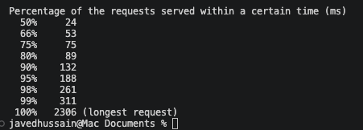
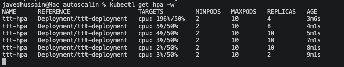

# Scaling the App with HPA


The goal is to automatically scale the `ttt` app between 2 and 10 pods 
- based on CPU usage using HPA
- then test it with Apache Bench.

## Metrics Server

- HPA needs live CPU and memory numbers
- metrics-server provides them
- It collects usage from each node and exposes it through the Kubernetes API.

```bash
kubectl apply -f https://github.com/kubernetes-sigs/metrics-server/releases/latest/download/components.yaml
kubectl patch deployment metrics-server -n kube-system --type='json' \
  -p='[{"op":"add","path":"/spec/template/spec/containers/0/args/-","value":"--kubelet-insecure-tls"}]'
```

- The first command installs metrics-server.
- The second adds `--kubelet-insecure-tls`, which Docker Desktop needs because its kubelet uses a self-signed certificate.
- `kubectl top nodes` and `kubectl top pods` confirm it works.

## 2. Resource Requests and Limits
- This is added to the app deployment
```yaml
resources:
  requests:
    cpu: 100m
    memory: 128Mi
  limits:
    cpu: 200m
    memory: 256Mi
```
- **requests** are the amount of CPU and memory a pod is guaranteed 
  - The scheduler uses them to place pods on nodes.
  - Acts as a baseline that the HPA measures against
- **limits** are the maximum a pod may use.
- `100m` means 100 millicores, or 0.1 of a CPU core.
- HPA calculates CPU usage as a **percentage of the request**, so without a request it can't work (it shows `<unknown>`).
- The `replicas` line was removed from the Deployment, so the HPA controls the pod count and `kubectl apply` doesn't reset it.

## 3. The HPA
- define the actual autoscaler
```yaml
apiVersion: autoscaling/v2
kind: HorizontalPodAutoscaler
metadata:
  name: ttt-hpa
spec:
  scaleTargetRef:
    apiVersion: apps/v1
    kind: Deployment
    name: ttt-deployment
  minReplicas: 2
  maxReplicas: 10
  metrics:
    - type: Resource
      resource:
        name: cpu
        target:
          type: Utilization
          averageUtilization: 50
```

| Field | What it does |
|---|---|
| `scaleTargetRef` | The object to scale: the `ttt-deployment` Deployment |
| `minReplicas: 2` | Never fewer than 2 pods |
| `maxReplicas: 10` | Never more than 10 pods |
| `type: Resource` / `name: cpu` | Scale on CPU usage |
| `averageUtilization: 50` | Target an average of 50% of the requested CPU across all pods |

- How it decides: every ~15 seconds the HPA compares the average CPU to the target. If usage is above 50%, it adds pods. If it is well below, it removes them. The rough formula is:

```bash
kubectl apply -f <file>.yaml
kubectl get hpa
```

## 4. Load Test with Apache Bench

```bash
ab -n 200000 -c 100 http://localhost:30002/
```

| Option | Meaning |
|---|---|
| `-n 200000` | Send 200,000 requests in total |
| `-c 100` | Keep 100 requests running at the same time |
| `http://localhost:30002/` | The app's NodePort URL |

This floods the app with traffic, which pushes CPU above the 50% target and triggers scaling.

To watch it happen:

```bash
kubectl get hpa -w
kubectl get pods
```

### Scaling Back Down

When the test ends, CPU drops and the HPA reduces the pods back toward 2. This takes about **5 minutes**, because the HPA waits (a "stabilization window") before scaling in so that it doesn't remove pods during a brief dip in traffic.

This is the ab request


Here is the autoscaler 


- Before load: 2 pods, low CPU
- Under load: CPU above 50%, pods scale up (maximum 10)
- After load: pods scale back down to 2