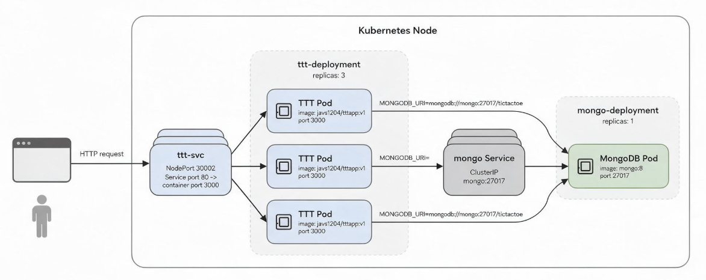

# TTT App and MongoDB Deployment



## Overview

The deployment runs three TTT app Pods and one MongoDB Pod.
The app is exposed through a NodePort Service, while MongoDB
is accessed through an internal ClusterIP Service.

## Request Flow

```text
Browser → Node IP:30002 → ttt-svc:80 → TTT Pod:3000
                                          ↓
                                    mongo:27017
                                          ↓
                                     MongoDB Pod
```

## 1. TTT Deployment

- `apiVersion: apps/v1`: API version used for Deployments.
- `kind: Deployment`: Defines and manages the app Pods.
- `metadata.name: ttt-deployment`: Names the Deployment.
- `replicas: 3`: Runs three copies of the app.
- `selector.matchLabels`: Identifies Pods labelled `app: ttt`.
- `template`: Defines the configuration for each Pod.
- `template.metadata.labels`: Gives each Pod the label `app: ttt`.
- `containers.name: ttt`: Names the container.
- `image: javs1204/tttapp:v1`: Specifies the app image.
- `containerPort: 3000`: Declares the app’s listening port.
- `env`: Sets environment variables inside the app container.

### MongoDB Connection

`MONGODB_URI=mongodb://mongo:27017/tictactoe`

- `mongo`: Internal MongoDB Service name.
- `27017`: MongoDB port.
- `tictactoe`: Database name.

## 2. TTT Service

- `apiVersion: v1`: API version used for Services.
- `kind: Service`: Provides a network entry point for the app.
- `metadata.name: ttt-svc`: Names the Service.
- `namespace: default`: Places it in the default namespace.
- `type: NodePort`: Allows access through a node’s IP address.
- `nodePort: 30002`: Port used to access the app externally.
- `port: 80`: Port exposed by the Service inside the cluster.
- `targetPort: 3000`: Port receiving traffic in the app containers.
- `selector: app: ttt`: Routes requests to the three TTT Pods.

There is one TTT Service serving three app Pods—not three Services.

## 3. MongoDB Service

- `metadata.name: mongo`: Provides the name used in MONGODB_URI.
- `type: ClusterIP`: Makes the Service internal to the cluster.
- `selector: app: mongo`: Selects the MongoDB Pod.
- `port: 27017`: Service port.
- `targetPort: 27017`: MongoDB container port.

All TTT Pods connect through this Service rather than directly
to the MongoDB Pod.

## 4. MongoDB Deployment

- `metadata.name: mongo`: Names the database Deployment.
- `replicas: 1`: Runs one MongoDB Pod.
- `selector.matchLabels`: Identifies Pods labelled `app: mongo`.
- `template.metadata.labels`: Applies that label to the Pod.
- `containers.name: mongo`: Names the database container.
- `image: mongo:8.0`: Specifies the MongoDB image.
- `containerPort: 27017`: Declares MongoDB’s listening port.

## Notes

- `---` separates the four resources in the YAML file.
- Apply all resources to the default namespace for this setup.
- The diagram calls the database Deployment `mongo-deployment`,
  but the YAML names it `mongo`.

## ClusterIP vs Node IP

- **ClusterIP:** An internal IP assigned to a Kubernetes Service. It gives Pods a stable way to communicate—for example, the TTT app reaches MongoDB through `mongo:27017`.

- **Node IP:** The IP address of a machine running Kubernetes. It identifies the machine, not a specific application.

- **NodePort:** A Service type that exposes an app through a node’s IP and a port—for example, `http://<Node-IP>:30002` reaches the TTT app.

## Deploy and Check

kubectl apply -f ttt-with-mongo.yaml

## Local Access

`kubectl port-forward -n default svc/ttt-svc 3001:80`
- This creates a temporary connection so you can open your Kubernetes app at port 3001
- It forwards trafic from computer to pod bypassing NodePort 30002

Keep the terminal open and visit http://localhost:3001.